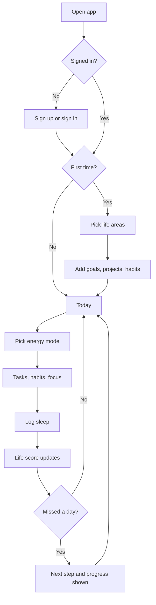
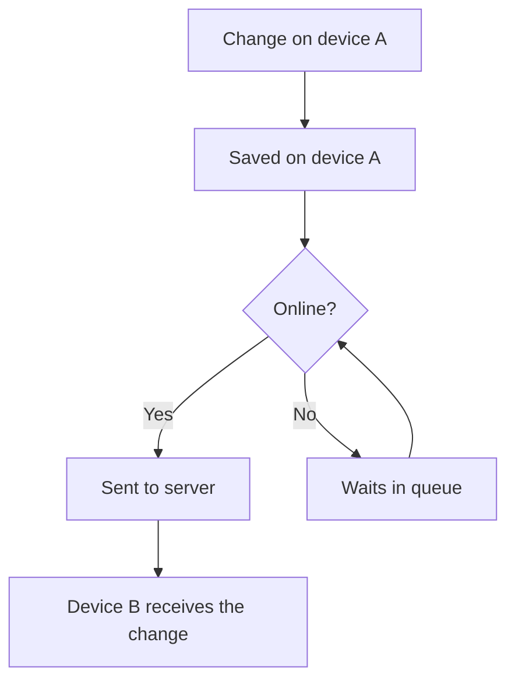
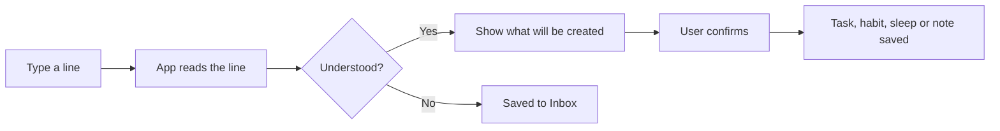

# User-Flows.md
Project: Orbito | Version: 0.2 | Date: 2026-11-11
Status: NEEDS REVIEW

Revision note (2026-11-11): the founder moved accounts, server and sync across devices into the first release (P0). Version 0.2 replaces the approved 0.1 and needs re-approval.

## 1. User journey
1. The user opens the app for the first time and picks a few life areas.
2. The user adds goals, projects, tasks and habits, or uses the Quick Launcher.
3. Each day the user opens Today, picks an energy mode, works through tasks and habits, and runs focus sessions.
4. The user logs sleep.
5. After enough days, the user sees the Life score and (in P1) insights.
6. After a missed day, the user sees a next step and their progress so far.

## 2. Registration and authentication flow
First release: the user signs up or signs in. A new user creates an account, then goes through first-run setup. A returning user signs in and their data downloads to the device. The user can sign out, export data and delete the account from Settings. Sign-in method: TBD - pending Phase 03 and Phase 04.

## 3. Main navigation structure
Main areas: Today, Tasks, Habits, Focus, Sleep, Inbox, Goals, Projects, Life areas, Settings (including Account and sync status). P1 adds Notes, Insights and Analytics. Mobile and desktop layouts differ; mobile uses a tab bar with five tabs. Final structure: TBD - pending Phase 05 approval.

## 4. Screen list and screen-to-screen interactions
Today to Tasks, Habits, Focus, Sleep. Quick Launcher is available from every screen. Goals link to projects, projects to tasks. A task opens its project or goal. Settings controls dashboard sections and energy-mode routines. The full screen list is in the design canvas and will be confirmed in Phase 05.

## 5. Feature workflows (user action -> system response)
- Add a task: user enters a title -> the task is saved and shown -> related project and goal update.
- Tick a habit: one tap -> the habit is marked done -> progress updates.
- Quick Launcher: user types a line -> app shows what it will create -> user confirms -> item is saved, or the line goes to the Inbox.
- Start focus: user picks a task and starts -> timer runs -> user stops -> time is saved to the task, project and goal.
- Switch energy mode: user taps a mode -> Today shows that mode's routine.
- Missed day: app detects missed items -> shows one next step and progress summary.
- Customise dashboard: user opens Settings -> toggles sections -> Today updates.
- Sign up: user enters details -> account is created -> first-run setup starts.
- Sync: user changes something -> saved on the device at once -> sent to the server in the background -> appears on the user's other devices.

## 6. Error and recovery flows
- App closes during a focus session: elapsed time is recovered on next open.
- Save fails: the user's input is kept and the user is told.
- Unreadable Quick Launcher line: saved to the Inbox.
- Storage full: the user is told and nothing is deleted.
- No internet: P0 features keep working and changes sync later.
- Sign-in fails: a clear message and a way to reset access (method TBD - pending Phase 04).
- Sync keeps failing: the user is told, nothing is lost, and the app retries.

## 7. Flow diagrams (Mermaid)

