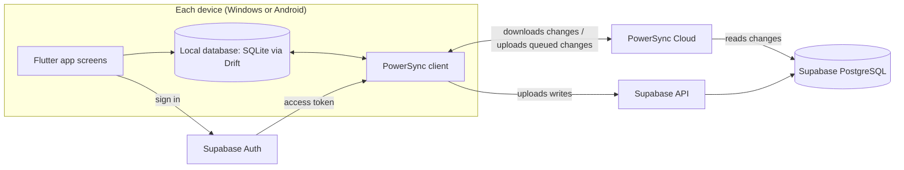
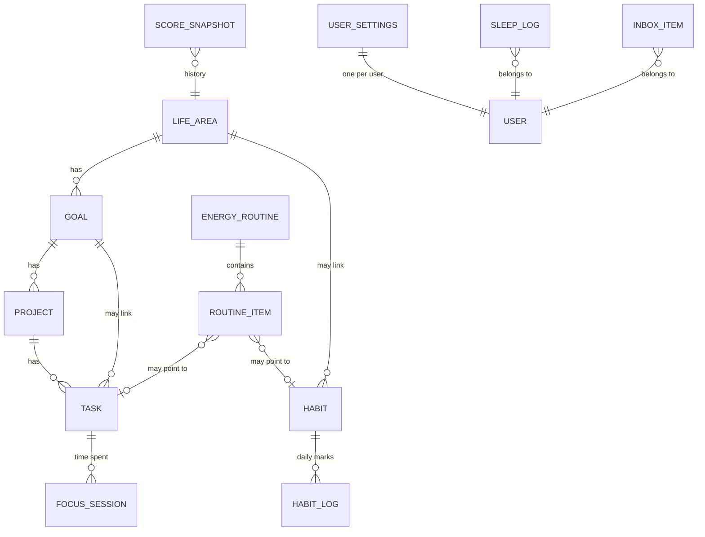
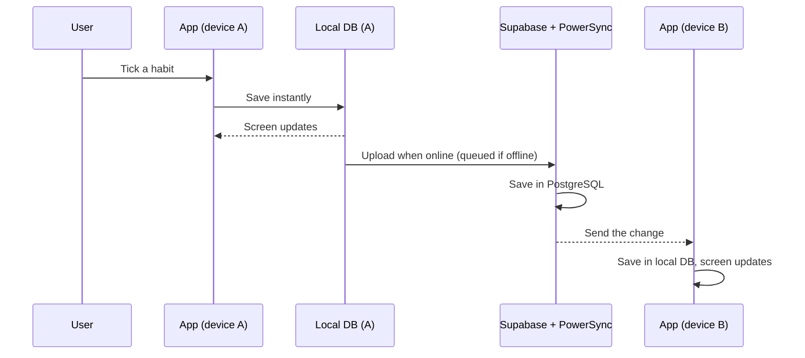

# System-Architecture.md
Project: Orbito | Version: 0.1 | Date: 2026-11-11
Status: NEEDS REVIEW

Scope: first release (Windows and Android, closed test with friends, $0). Items marked "TBD - pending Phase 06" must be proven by a small test before they are relied on. The PowerSync and Supabase combination in particular has not yet been proven in this project.

## 1. High-level architecture (diagram)
The app stores everything on the device first. A sync engine copies changes between the device and a hosted database. No custom server is written in the first release.



## 2. Frontend architecture
- One Flutter app for Windows and Android (Apple versions later from the same code).
- Layers: screens (UI), state, domain rules (score, energy modes, fail-day step), and data (local database access).
- The screens read only from the local database. They never wait for the network. This is what makes the app work offline and feel fast.
- Business rules run on the device, so no custom server logic is needed in the first release.

## 3. Backend architecture
- Supabase provides the PostgreSQL database, sign-in and access rules.
- PowerSync Cloud streams each user's rows to their devices.
- No custom backend code in the first release, with one likely exception: deleting an account needs a small server-side function (TBD - pending Phase 06).

## 4. Database schema and relationships (ER diagram)
Every table has: id (a unique code made on the device), user_id, created_at, updated_at, deleted_at (marks a deletion so other devices learn about it).


- TASK: title, status, priority, due date, project and goal links, completed_at.
- HABIT_LOG: habit, date, done.
- SLEEP_LOG: sleep time, wake time, note.
- ENERGY_ROUTINE: mode (low, medium or high) and its items.
- USER_SETTINGS: visible dashboard sections and their order.
- SCORE_SNAPSHOT: stored score history per life area. Formula: TBD - pending founder decision.
- Exact columns are finalised in Phase 06.

## 5. API structure
- No custom REST API in the first release. The app talks to three services: Supabase Auth (sign in), PowerSync (receive changes) and Supabase (upload queued changes).
- Data export is built on the device from the local database.
- Account deletion: one server-side function (TBD - pending Phase 06).

## 6. Authentication and authorization
- Sign-in method (proposed): email and password with email verification. Other methods can be added later. Final choice: TBD - pending founder decision.
- After sign-in the app receives an access token, kept in the device's secure storage.
- Authorization uses database access rules ("row level security" in Supabase): a user can read and change only rows where user_id is their own. These rules are tested for every table before the closed test.
- The app contains only the public project key that Supabase intends for apps; no secret key is ever placed in the app.

## 7. Data flow


## 8. State management
- Screens observe the local database, so state follows the data. The choice of a Flutter state library is an implementation choice: TBD - pending Phase 06.

## 9. Error handling
- Local save fails: the user's input is kept and the user is told. Nothing is discarded.
- Upload fails or no connection: changes stay in the queue and retry with growing waits; the screen shows a small sync status and never blocks the user.
- Sign-in fails: a clear message and a reset option.
- Server paused or unavailable (free plan after inactivity): the app keeps working locally and shows "sync paused".
- Unexpected errors are logged on the device; error reporting service: TBD - pending Phase 06 (a free option will be checked).

## 10. Security architecture
- Data in transit: encrypted connections (HTTPS) to Supabase and PowerSync.
- Data at rest on the server: to be confirmed on Supabase's own documentation. TBD - pending Phase 06.
- Data on the device: stored in the app's private storage; device-level encryption depends on the operating system.
- Access rules per user on every table (section 6). No secret keys in the app.
- Privacy: no ads, no selling of data. A short privacy note, data export and account deletion are required before friends sign up. Legal requirements by country: to be verified before public launch.
- Backups: the free Supabase plan has none (verified). For the closed test the main protection is that each device keeps its own copy and can export. A scheduled backup of the database is a requirement before public sales.

## 11. Offline and sync strategy
- Local first: every action works offline.
- New records get a unique code on the device, so two devices never create clashing records.
- Deletions are marked, not removed, so other devices learn about them.
- Conflict rule (proposed): if the same record was changed on two devices, the latest change wins, judged by server time rather than the device clock. Final rule: TBD - pending founder decision.
- A new device signing in downloads the user's data first, with a progress message.
- Free-plan limits (verified): Supabase and PowerSync free projects pause after inactivity and must be reactivated by hand.

## 12. Third-party integrations
- First release: Supabase and PowerSync only.
- Later: calendar services (P1, TBD), subscription billing (P1, TBD), AI helpers (P2).

## 13. Folder and file structure
Proposed, final in Phase 06:
```
orbito-app/
  lib/
    app/            start-up, navigation, theme
    features/       tasks, habits, focus, sleep, areas_goals_projects,
                    dashboard, quick_launcher, energy_modes, score, account
    data/           local database, sync, repositories
    domain/         score rules, energy-mode rules, fail-day step
    ui/             shared components from the design system
  test/             automated tests
  supabase/         database setup scripts and access rules
  docs/             project documents
```

## 14. Development milestones
1. **M0 Environment and proof:** a Flutter app builds and runs on Windows and Android; a tiny test proves local database, sign-in and sync between two devices. This test removes the biggest risks first.
2. **M1 Core data:** life areas, goals, projects, tasks.
3. **M2 Daily tracking:** habits, sleep, focus timer.
4. **M3 Home and capture:** customisable Today dashboard, Quick Launcher and Inbox.
5. **M4 Guidance:** energy modes, life score, fail-day next step. MOVED TO V2 on 2026-11-13 (not built in v1). The tables ENERGY_ROUTINE, ROUTINE_ITEM and SCORE_SNAPSHOT are created in v2.
6. **M5 Accounts and hardening:** sign-up and sign-in, access rules tested, export, account deletion, error handling.
7. **M6 Closed test:** Windows and Android builds shared with friends, feedback collected.
Each milestone ends with a demo and your approval before the next one (Phase 07 rule).

## Open items for the founder
1. Sign-in method (proposed: email and password).
2. Conflict rule (proposed: latest change wins).
3. Score formula and stage names (carried over from earlier phases).
